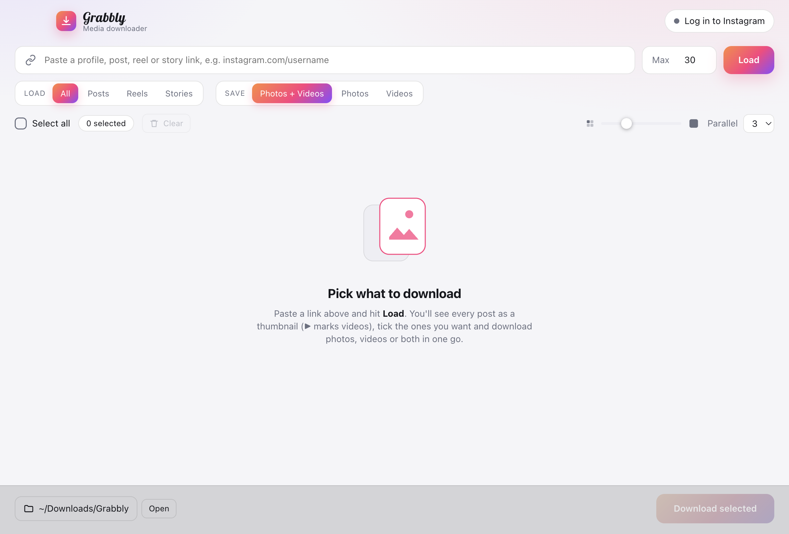
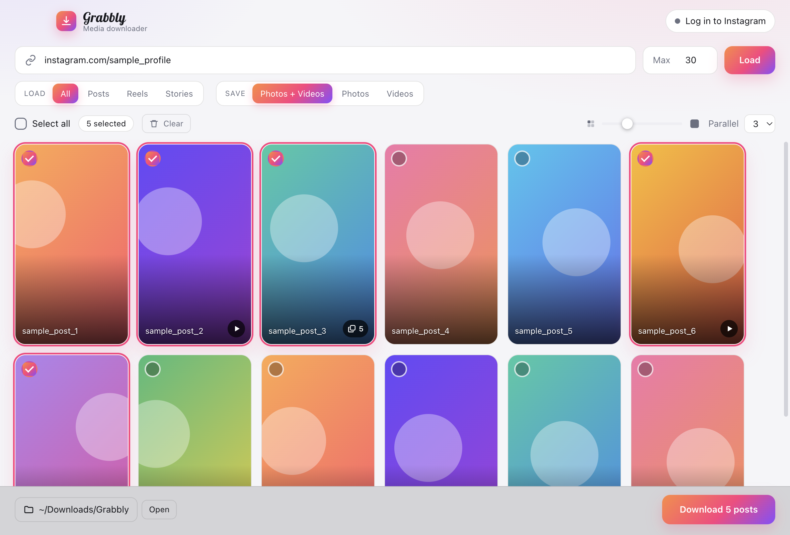
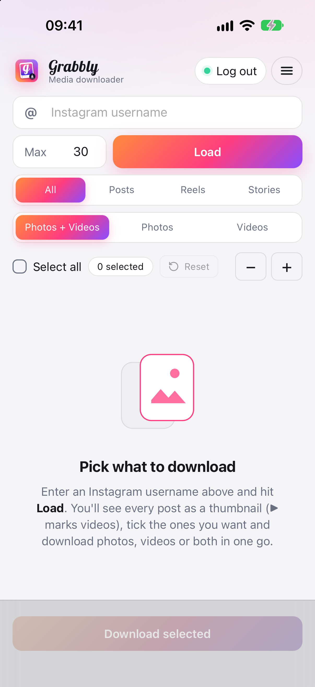
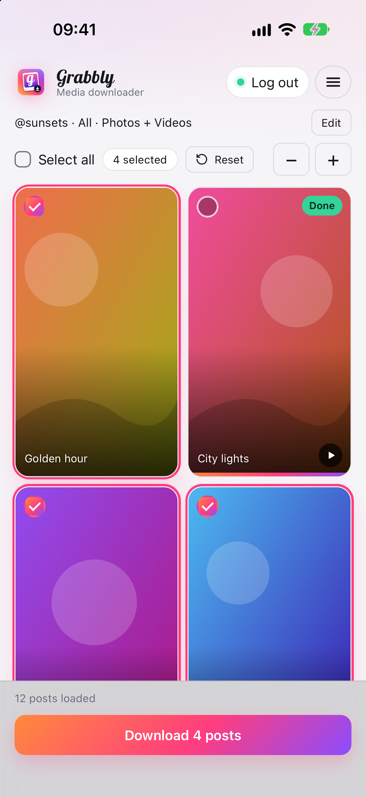
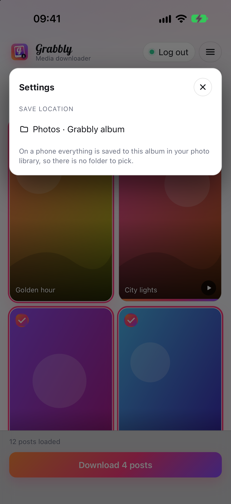

# Grabbly

**Bulk media downloader for social profiles.**

Desktop app for macOS and Windows. Enter an Instagram username, see every post as a thumbnail, tick what you want and save it in bulk.

## Screenshots

Desktop (below):





Mobile (below):

  

The results screenshots use generated placeholder thumbnails, not real posts.

## What it downloads

- **Posts & Reels** from a profile: photos, videos, carousels (every slide is saved as its own file).
- **Stories** (active ones, they live 24 hours) of a profile.
- Card size: − / + buttons (desktop: thumbnail size; phone: 1–4 columns).
- The field takes just the profile name (a missing profile is reported right away) (`name` or `@name`); full Instagram links still work too.
- Choose **Photos + Videos**, **Photos** or **Videos**. The filter also applies inside carousels.

Thumbnails: ▶ marks a video, stacked squares mark a carousel (with the slide count), photos have no mark.

Files go to the chosen folder as `user_CODE.jpg|mp4`, carousels as `user_CODE_1.jpg`, `user_CODE_2.mp4`, stories as `user_story_ID.ext`. Existing files are skipped.

## Run

```
npm install
npm start
```

## Build installers

```
npm run dist:mac   # .dmg (Apple Silicon + Intel), run on macOS
npm run dist:win   # .exe installer + portable (x64)
```

Icons, splash screens, fonts, colours and style notes live in [`design/`](design/README.md).

## Releases

Every version is published the same way, with one script that bumps the version, builds all installers, tags and creates the GitHub Release:

```
scripts/release.sh 2.0.3
```

It needs macOS with Xcode, JDK 21, the Android SDK and a logged-in `gh`. Each release carries six files: `Grabbly-arm64.dmg`, `Grabbly-x64.dmg`, `Grabbly-Setup.exe`, `Grabbly-Portable.exe`, `Grabbly-android-debug.apk` and `Grabbly-ios-simulator.zip` (iOS runs in the Simulator only, a real iPhone needs signing). Old releases stay; every run adds a new version.

`npm test` runs the unit tests. `test/e2e.js` runs against a real account (needs a cookies file, see the header of the script).

## Branding

See [`design/`](design/README.md) for every icon, colour and font. The app icon (`build/icon.svg`, rendered to `build/icon.png`) uses the "g" glyph from **Lobster** by Impallari Type, licensed under the SIL Open Font License 1.1. The font file and license are in `assets/fonts/`.
